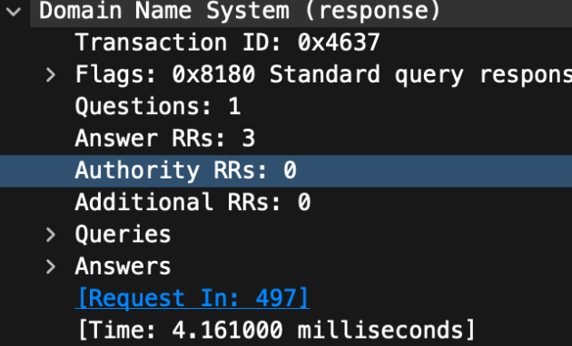
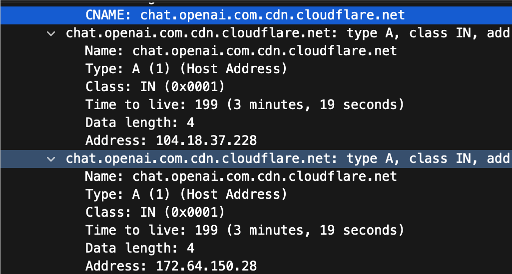
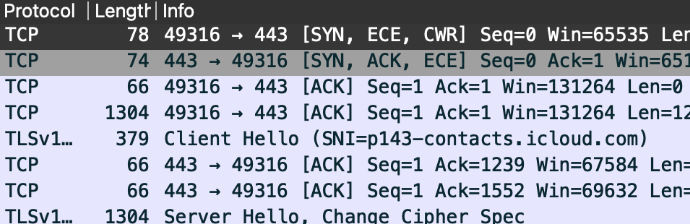

# Packet Analysis Findings

[Project overview](../README.md)

## DNS lookup for `chat.openai.com`

With the `dns` display filter applied, packet **497** requested an IPv4 address for `chat.openai.com`. Packet **501** returned a successful response. Both carried transaction ID `0x4637`, and Wireshark linked the response back to packet 497.

| Answer type | Name | Value |
| --- | --- | --- |
| CNAME | `chat.openai.com` | `chat.openai.com.cdn.cloudflare.net` |
| A | `chat.openai.com.cdn.cloudflare.net` | `104.18.37.228` |
| A | `chat.openai.com.cdn.cloudflare.net` | `172.64.150.28` |

A **CNAME** points one hostname to another. An **A record** gives an IPv4 address. The two A records give the client two possible destinations. Packet traffic to an address would be separate evidence that the client used it.

Wireshark measured **4.161 ms** between the query and its reply. The displayed timestamps give the same result: `(6.307126 − 6.302965) × 1000 = 4.161 ms`. This is the time for one DNS exchange as seen in the capture.





## TCP connection to `17.248.228.12:443`

I used this display filter to follow packets in both directions between the Mac's temporary client port `49316` and the remote endpoint.

```wireshark
ip.addr == 17.248.228.12 && tcp.port == 49316
```

| Packet | Capture time (s) | Direction | Handshake step |
| --- | ---: | --- | --- |
| 176 | 3.235483 | Mac:49316 → 17.248.228.12:443 | SYN. The Mac requests a connection and sends its initial sequence number. |
| 186 | 3.242442 | 17.248.228.12:443 → Mac:49316 | SYN-ACK. The server acknowledges the request and sends its initial sequence number. |
| 189 | 3.245051 | Mac:49316 → 17.248.228.12:443 | ACK. The Mac acknowledges the server's sequence number, completing the three-way handshake. |

The SYN also carries ECE and CWR, and the SYN-ACK carries ECE. These flags are part of negotiating Explicit Congestion Notification, which lets endpoints react to network congestion signals. The elapsed time from the first SYN to the final ACK was **9.568 ms**, calculated as `(3.245051 − 3.235483) × 1000` from the capture timestamps.

## TLS on the same TCP connection

- **Packet 191, Client Hello.** The Mac offered TLS settings. The **Server Name Indication (SNI)** field named `p143-contacts.icloud.com`, the hostname the client wanted to reach.
- **Packet 194, Server Hello.** The server replied with its TLS selections. Wireshark also lists Change Cipher Spec in that frame.



TCP establishes the connection. TLS uses that connection to negotiate protection for the data. The two Hello messages show the start of negotiation and expose the requested hostname in this capture. They give no visibility into the contents of an encrypted request.

The TCP and TLS example belongs to the iCloud hostname shown in SNI. Its destination, `17.248.228.12`, differs from both addresses returned by the ChatGPT lookup. The three protocols illustrate different jobs, and the evidence covers two separate exchanges.
